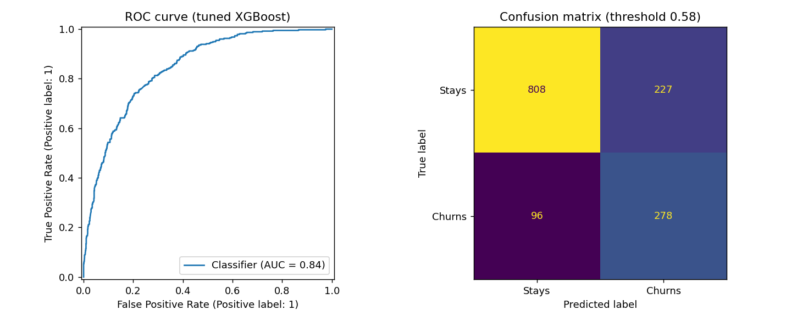
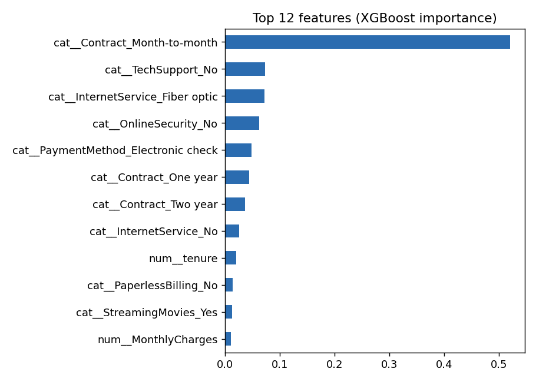

# Customer Churn Prediction + Streamlit App

A supervised machine learning project that predicts whether a telecom customer is likely to leave (churn). It covers the full workflow: data cleaning, preprocessing, handling class imbalance, model comparison, hyperparameter tuning, threshold selection and deployment as an interactive web app.

**Live demo:** https://YOUR-REAL-LINK.streamlit.app

<!-- After adding screenshots to an images/ folder, uncomment these lines:


-->

## Problem

Winning a new customer costs much more than keeping an existing one. If a company can tell in advance which customers are likely to leave, it can offer a discount or a call before they go. This project outputs a churn probability for every customer.

## Dataset

[Telco Customer Churn](https://www.kaggle.com/datasets/blastchar/telco-customer-churn) (IBM sample dataset): 7,043 customers, 19 input features and a Yes/No churn label. About 26.5% of customers churned.

| Group | Features |
|---|---|
| Demographics | gender, SeniorCitizen, Partner, Dependents |
| Services | PhoneService, MultipleLines, InternetService, OnlineSecurity, OnlineBackup, DeviceProtection, TechSupport, StreamingTV, StreamingMovies |
| Account and billing | tenure, Contract, PaperlessBilling, PaymentMethod, MonthlyCharges, TotalCharges |

## Approach

1. **Cleaning:** `customerID` dropped. `TotalCharges` is text in the raw file (blank for brand-new customers), so it was converted to numeric.
2. **Split:** 80/20 stratified train-test split (5,634 train, 1,409 test). The test set is used only for final reporting.
3. **Preprocessing:** `StandardScaler` for numeric columns and `OneHotEncoder` for categorical columns, inside a scikit-learn `Pipeline` so training and the app use identical steps.
4. **Class imbalance:** compared class weights, SMOTE (inside the pipeline so it only touches training folds) and XGBoost `scale_pos_weight`.
5. **Metrics:** accuracy is misleading when only 26.5% of customers churn, so models are judged on ROC-AUC, recall, precision and F1.
6. **Tuning:** `RandomizedSearchCV` on XGBoost, 15 combinations, 5-fold stratified cross-validation, scored on ROC-AUC.
7. **Threshold:** the decision threshold (0.58) is chosen from out-of-fold predictions on the training set only, so the test set stays untouched.
8. **Deployment:** the trained pipeline and threshold are saved with joblib and served through Streamlit.

## Results (held-out test set)

| Model | ROC-AUC | Recall | Precision | F1 |
|---|---|---|---|---|
| LogReg (class weights) | 0.842 | 0.783 | 0.504 | 0.614 |
| LogReg + SMOTE | 0.840 | 0.797 | 0.503 | 0.617 |
| RandomForest (class weights) | 0.842 | 0.749 | 0.552 | 0.636 |
| XGBoost (scale_pos_weight) | 0.842 | 0.786 | 0.512 | 0.620 |
| **XGBoost tuned, threshold 0.58** | **0.845** | 0.743 | 0.550 | 0.633 |

All models rank customers about equally well (ROC-AUC around 0.84). Tuning gave a small gain, and the threshold mainly controls the trade-off between recall (catching churners) and precision (avoiding false alarms). Exact values may vary slightly if you re-run training; see `model/results.csv`.




## Tech stack

Python, pandas, NumPy, scikit-learn, XGBoost, imbalanced-learn, Matplotlib, joblib, Streamlit

## Run it locally

Use a virtual environment so the project's packages stay separate from the rest of your system.

**Windows (PowerShell / CMD)**
```bash
python -m venv .venv
.venv\Scripts\activate
```

**macOS / Linux**
```bash
python3 -m venv .venv
source .venv/bin/activate
```

Then, with `(.venv)` showing in your terminal:
```bash
pip install -r requirements.txt
python src/train.py        # trains, tunes, saves model/ + plots (about 1-2 min)
streamlit run app.py       # opens the dashboard in your browser
```

## Project structure

```
data/telco_churn.csv     Telco Customer Churn dataset
src/train.py             preprocessing, imbalance handling, tuning, evaluation
model/                   saved pipeline, metrics and plots
app.py                   Streamlit dashboard
requirements.txt         pinned dependencies
```

## How the app works

Streamlit re-runs `app.py` whenever an input changes. The app loads the saved pipeline once, builds a one-row table from the inputs, calls `predict_proba`, and compares the result with the 0.58 threshold to show a low, medium or high risk message. Nothing is stored and there is no database.

## Limitations

- One clean public dataset; real company data would be messier.
- Gains from tuning were small.
- The app gives a probability but not the reason for each prediction.
- `TotalCharges` is estimated as tenure multiplied by monthly charges in the app.
- Not tested on data from a later time period.

## Next steps

- Add SHAP for per-customer explanations
- Try LightGBM and CatBoost
- Use a cost-based threshold (cost of a retention offer versus a lost customer)
- Test on newer data
